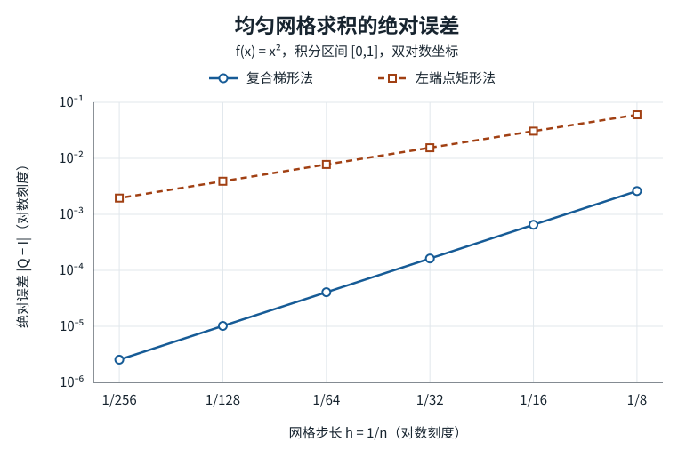

# 积分 $x^2$ 时，均匀网格加倍能减小多少误差？

## 摘要

在 $[0,1]$ 上积分 $x^2$，用同一组均匀网格比较复合梯形法与左端点矩形法。以解析积分为参考，最后一次加密时，梯形法的经验阶约为二，左端点法的经验阶约为一。在所测网格上，两种方法的误差都随网格加密而下降，梯形法下降更快。

## 研究问题

在同一均匀网格上，复合梯形法和左端点矩形法都用节点函数值估算积分。本文检验两种方法的误差随网格加密的变化率。梯形笔记 [1] 给出真值与梯形法偏差；左端点笔记 [2] 给出两种求积结果之差的望远镜推导。左端点法作为预期收敛但达不到二阶的负对照。

## 方法

将 $[0,1]$ 等分为 $n$ 个面板，步长 $h=1/n$，节点 $x_i=ih$。两组都取 $f(x_i)=x_i^2$。左端点法逐面板累加 $hf(x_i)$，梯形法则累加 $h[f(x_i)+f(x_{i+1})]/2$。正式网格的面板数为 8、16、32、64、128、256；另用 2 个面板试跑，检查端点权重和符号，试跑结果不纳入正式分析。

设求积估计为 $Q_n$、真值为 $I$。记录带符号误差 $Q_n-I$ 和绝对误差 $E(n)=|Q_n-I|$，二者都与积分同单位，本题无量纲。经验收敛阶 $p=\log_2[E(n)/E(2n)]$ 记在细网格一行。[冻结方案](plan.json)规定：最后一对网格的经验阶距预测值不超过 0.01；全网格的带符号误差还须在 $10^{-14}$ 内与解析式吻合，且符号相同。解析式以 Python 浮点数求值，只用于比较，不参与生成求积估计。

由原函数在积分端点作差，得到本题的解析参考值 1/3。 [C1]

解析对照来自两份笔记。对 $x^2$，梯形插值线在曲线上方，单个面板多计的面积为 $h^3/6$，累加得到带符号误差 $h^2/6$ [1]。梯形法与左端点法的逐面板差相加后，内部端点抵消，只剩 $h[f(1)-f(0)]/2=h/2$，因此左端点法的带符号误差为 $h^2/6-h/2$ [2]。

## 结果

最后一对网格为 128→256；下列带符号误差取自细网格，经验阶则由这一对网格计算。

复合梯形法在 n=256 的带符号误差为 +2.54313e-6，经验阶为 2.00000，符合冻结的二阶判据。 [C2]

左端点矩形法在 n=256 的带符号误差为 -1.95058e-3，经验阶为 0.99812，符合冻结的一阶判据。 [C3]

在全部正式网格上，梯形法、左端点法的带符号误差相对各自解析式的最大绝对偏差分别为 1.865e-17 和 2.082e-17，均在冻结容差内，且两组各网格的符号均与解析预测一致。 [C4]

**图 1.** 横轴为网格步长，向左表示网格加密；纵轴为绝对误差。每条曲线包含六个正式网格，每点为一次确定性求积，不画抽样误差条。原始数据见 [results.csv](results.csv)，解析式对照汇总见 [consistency.csv](consistency.csv)。在项目副本的根目录依次运行 `python3 research/experiment.py --pilot` 和 `python3 research/experiment.py`，可重建这两份数据和误差图。

## 讨论与局限

梯形法的偏差只含 $h^2$ 项，步长减半使误差约为原来的四分之一。左端点法由 $h$ 项主导，但还有 $h^2$ 修正项，因而有限网格上的误差并不恰好减半。这也解释了它最后一次加密的经验阶接近一而不等于一。本实验只检验给定二次函数、区间和网格范围，不用这些数据外推到其他函数或更细网格的舍入误差区间。

## 参考资料

1. [Exact reference and trapezoid bias](../inputs/trapezoid-note.md)，本地笔记，第 5、7、9 行。
2. [Why left endpoints are a negative control](../inputs/left-note.md)，本地笔记，第 5、7、9 行。
