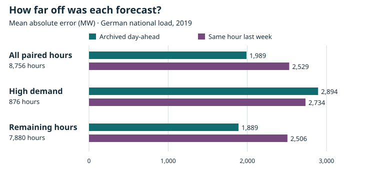

# Germany's day-ahead load forecast beat last week's load on average, but not at high demand in 2019

**Abstract.** Which was closer to German electricity demand: the recorded day-ahead forecast or last week's load at the same hour? We compared their errors over a full year and separately during high demand.
Across 8756 paired hours, the archived day-ahead forecast missed German national demand by 1989 MW on average, against 2529 MW for the same hour a week earlier. [C1]
The ranking reversed in the 876 hours with realized load at or above 69058 MW: mean absolute error was 2894 MW for day-ahead and 2734 MW for last week. [C2]
These are comparisons of group averages, not a rule for choosing a forecast before the load is known.

## Data and comparison

Open Power System Data (OPSD) identifies the two German national series as total load and day-ahead load forecast, both in MW and based on the ENTSO-E Transparency Platform. [C3]
Tzortzis and colleagues used a weekly seasonal-naive benchmark in their study of day-ahead forecasts for European national electricity demand. [C4]
Here the question is about an archived forecast, not a new model. We compare it with the preceding week's actual load at the **same German clock hour**. In a clock-change week that is not always a lag of 168 elapsed hours. Repeating the last week preserves weekday and hour, but makes no adjustment for public holidays or changing conditions.

We selected the 2019 local calendar year, the last full year in the release before pandemic disruptions. The preceding seven days supplied lag values only. We started from all 8760 physical hours between Berlin year boundaries. The two occurrences of the repeated autumn hour and two targets with an absent or ambiguous prior-week clock hour were excluded. No further hour was lost to a missing load or forecast ([coverage](coverage.json)); we did not interpolate or trim values. Both forecasts were scored on identical timestamps.

For each hour, we took the absolute difference between the forecast and realized load. The primary measure is the average of these errors (MAE, MW); smaller is better. Before seeing errors, we defined high demand by the nearest-rank 90th percentile of paired actual load, including ties. This gives both forecasts the same high-demand hours without using either error to select them. Because the definition uses realized load, an unexpected surge can qualify an hour that neither forecast identified in advance. The numbers describe all eligible hours in the specified archive year; we do not treat them as independent draws from future years.

## Results

*Figure 1. Each bar is an hourly mean, not a sum; the two bars in each group use the same deliveries. High demand and remaining hours partition the full sample. Labels are rounded to whole MW; no sampling interval is shown for this finite-period summary.*

In the remaining 7880 hours, MAE was 1889 MW for day-ahead and 2506 MW for last week. [C5]
The weekly-minus-day-ahead MAE difference was 540 MW overall, −159 MW at high demand and 618 MW in the remaining hours. [C6]
The differences use unrounded errors. The whole-year average thus conceals both the change in ranking and the larger absolute error of the day-ahead forecast in the busiest hours.

## Does the reversal depend on knowing the realized load?

The reversal raised a selection question: would it disappear if an hour qualified as busy without consulting its eventual load? After the first comparison, we [specified one sensitivity analysis](followup-decision.md): rank the same hours by the arithmetic midpoint of the two forecasts, weighting them equally. Keep the same percentile and tie rule; change only how hours qualify. The midpoint was used to group hours, not scored as a third model.

The midpoint threshold was 67818 MW; 670 of its 876 high-demand hours also qualified by realized demand. [C7]
Within the midpoint-selected group, day-ahead MAE was 2128 MW and last-week MAE was 1967 MW, a weekly-minus-day-ahead difference of −161 MW. [C8]
The disadvantage therefore survived this change of definition, even though the two definitions selected different hours. The sensitivity reuses the same observations and ranks them across the entire year; it is neither independent confirmation nor a test of a live switching rule.

## Scope

This comparison concerns the published national series, not a specific grid operator's model or Germany's individual bidding zones. The release does not reconstruct the exact values available at each forecast's issue time. No weather, holiday adjustment or competing fitted baseline was tested. The calculation identifies when the average ranking differed within this archive, not why it differed or whether it recurs in another year.

## References and data

- Open Power System Data (2020). *Data Package Time series*, version 2020-10-06. [DOI: 10.25832/time_series/2020-10-06](https://doi.org/10.25832/time_series/2020-10-06). Primary data: [ENTSO-E Transparency Platform](https://transparency.entsoe.eu/), processed by OPSD. [Release, field dictionary and downloads](https://data.open-power-system-data.org/time_series/2020-10-06/).
- Tzortzis, A. M., Pelekis, S., Spiliotis, E., Karakolis, E., Mouzakitis, S., Psarras, J., & Askounis, D. (2024 issue; published online December 2023). *Transfer Learning for Day-Ahead Load Forecasting: A Case Study on European National Electricity Demand Time Series*. **Mathematics**, 12(1), 19, §2.5. [DOI: 10.3390/math12010019](https://doi.org/10.3390/math12010019).

[Reproduce the analysis](../README.md) · [Primary results](primary.csv) · [Exploratory results](followup.csv)
