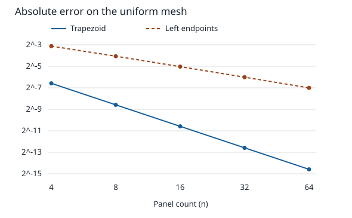

# When doubling the mesh quarters the error

**Abstract.** For the integral of x² on [0,1], composite trapezoids overestimate the area, but their error falls fourfold when the panel count doubles. Left-endpoint rectangles also converge, yet their errors fall only about twofold. A panel-level calculation explains the difference; a paired mesh-refinement experiment tests whether the implementation reproduces it.

## Prediction and method

The exact reference is 1/3. For f(x) = x², the line joining the panel endpoints lies above the curve in the panel interior: on a panel of width h, the integrated excess is h³/6. Summing over n equal panels gives a signed error of 1/(6n²) (Note A). Left rectangles miss the rise within each panel. Their composite estimate is lower than the trapezoid estimate by 1/(2n), so their absolute error has a leading term proportional to 1/n (Note B).

Following the [pre-execution protocol](plan.json), we evaluated the integrand at each mesh point for n = 4, 8, 16, 32 and 64. The trapezoid sum weights the two endpoints by one half; the left sum omits the last endpoint. We multiplied each sum by h = 1/n, then computed absolute error E against the reference in Python floating-point arithmetic. The observed order is log₂(E(n/2)/E(n)); it is undefined for the first row. The theoretical error formulas were used for comparison, not to generate either estimate.

## Results

At n=8 the trapezoid estimate is 0.3359375, above the exact integral as predicted by the positive panel bias. [C1]

At n=64 the observed trapezoid order rounds to 2.000000. [C2]

The left-sum order rises from 0.935870 on the first doubling to 0.992427 on the last, consistent with first-order rather than second-order decay. [C3]

**Figure.** Both axes are logarithmic. Each mark is a row in the [results table](results.csv); a steeper descending line indicates a larger observed order. Every trapezoid signed error matched the derived formula within the planned absolute tolerance. The left-sum errors declined on every refinement without meeting the trapezoid order criterion.

## What the experiment does and does not establish

The experiment checks the weighted sums, error ratios and agreement with a prediction on five meshes. It does not prove an asymptotic rate: that conclusion for this particular integrand follows from the exact error identities. The left control shows why decreasing error alone is insufficient evidence of second order. These meshes use exactly representable binary spacings, but 1/3 is rounded; small deviations of measured trapezoid order from two are not evidence against the identity. We did not test nonsmooth functions, nonuniform meshes or roundoff-dominated resolutions.

## Sources and reproduction

- **Note A:** [Exact reference and trapezoid bias](trapezoid-note.md), original derivation for this example.
- **Note B:** [Why left endpoints are a negative control](left-note.md), original derivation for this example.
- **External mathematical reference:** NIST *Digital Library of Mathematical Functions*, [§3.5(i), Trapezoidal Rules](https://dlmf.nist.gov/3.5#i). The local notes give the full argument needed here; no download is required.

From the example directory, `python3 run.py` recomputes the estimates and checks the thresholds in the protocol. See the [completion record](run.json) for the artifact hashes and the [claim ledger](claims.json) for the table cells and note excerpts behind the marked statements.
